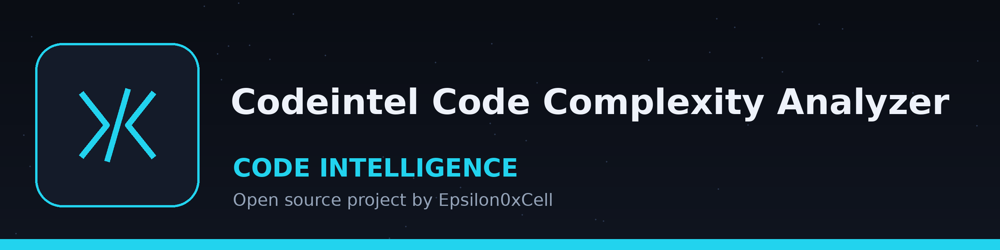

# codeintel-Code-Complexity-Analyzer
Calculates cyclomatic complexity and other code complexity metrics for Python code. Passes the original file text to the `radon` library for complexity calculation, so reported line numbers are true source line numbers. Reports only functions or classes exceeding the defined complexity threshold, and prints a plain line saying so when no block exceeds it. - Focused on Tools for static code analysis, vulnerability scanning, and code quality assurance

## Install
`git clone https://github.com/ShadowStrikeHQ/codeintel-code-complexity-analyzer`

## Usage
`./codeintel-code-complexity-analyzer [params]`

## Parameters
- `-h`: Show help message and exit
- `--threshold`: Complexity threshold for reporting functions/classes. Defaults to 10.
- `--report-raw`: No description provided

## License
Copyright (c) ShadowStrikeHQ
