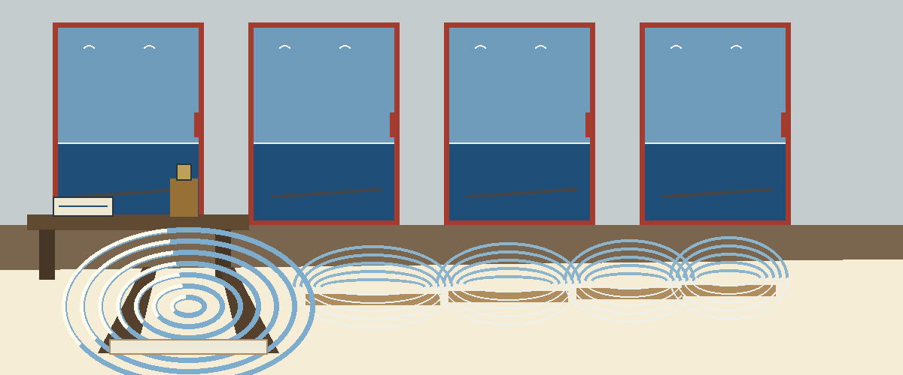
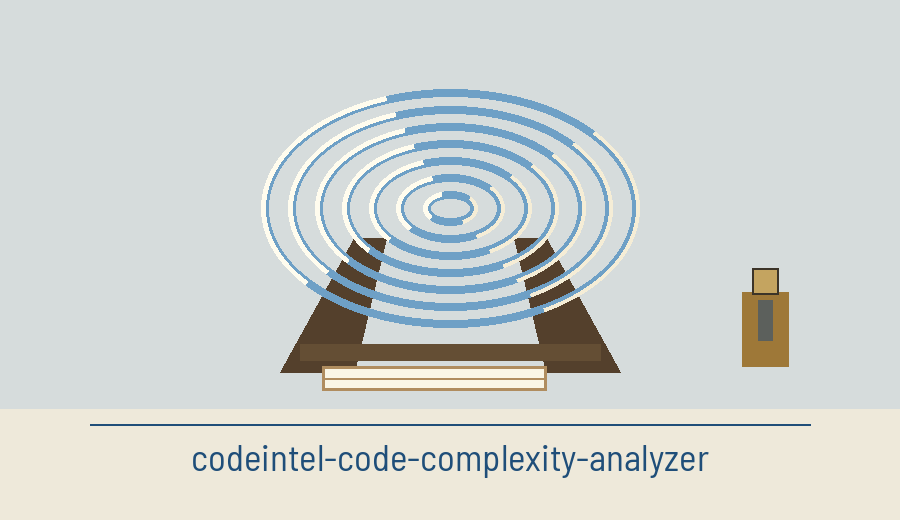
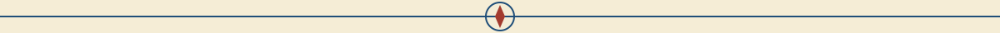
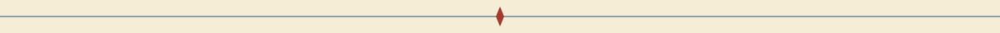

# codeintel-Code-Complexity-Analyzer

Ship log treatment: every heading is a log entry in Barlow Semi Condensed in harbour blue on sail cream, ruled below, with a rope knot at major headings alone.

Calculates cyclomatic complexity and other code complexity metrics for Python code. Passes the original file text to the `radon` library for complexity calculation, so reported line numbers are true source line numbers. Reports only functions or classes exceeding the defined complexity threshold, and prints a plain line saying so when no block exceeds it. - Focused on Tools for static code analysis, vulnerability scanning, and code quality assurance

> **Keeper log note, on the original text.** The opening account above keeps its radon and true line number wording as printed. The callouts in this README are reserved for that qualifier, the threshold default, the undescribed flag, and the missing usage target, and for nothing else.

## Install
`git clone https://github.com/ShadowStrikeHQ/codeintel-code-complexity-analyzer`

> **Keeper log note, flagged in place.** The install line above reads git clone https://github.com/ShadowStrikeHQ/codeintel-code-complexity-analyzer, naming ShadowStrikeHQ in place of ShadowGuard-AI. It is preserved exactly as printed and flagged here, never silently fixed.

## Usage
`./codeintel-code-complexity-analyzer [params]`

> **Keeper log note, flagged in place.** The usage line above names no input file, no directory, and no example target. That omission stands as printed, with this note beside it.

## Parameters
- `-h`: Show help message and exit
- `--threshold`: Complexity threshold for reporting functions/classes. Defaults to 10.
- `--report-raw`: No description provided

> **Keeper log note, on the threshold and the undescribed flag.** The list above keeps the default of 10 beside --threshold and the words No description provided beside --report-raw, exactly as printed.

## License
Copyright (c) ShadowStrikeHQ

> **Keeper log note, flagged in place.** The closing line above reads Copyright (c) ShadowStrikeHQ, naming the same wrong organisation a second time. It is preserved exactly as printed and flagged here, never silently fixed.
